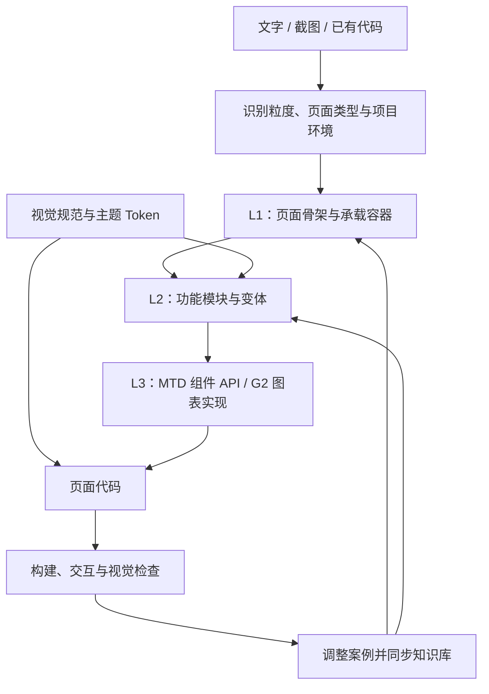

# B 端页面生成 Skill 与示范案例

将 B 端设计规范整理为 AI 可按需读取、执行和复用的知识体系，让 Agent 从文字、截图或已有代码出发，生成和修改结构合理、风格一致的 B 端页面。

项目面向通过 AI 参与页面开发的设计师、产品经理和研发人员，覆盖**数据看板、列表页、表单页、详情页**。核心方法是：**识别用户意图 → 选择页面骨架 → 装配功能模块 → 查询真实组件 API → 生成代码并验证**。

本仓库收录两部分：

| 资产 | 入口 | 作用 |
| --- | --- | --- |
| Skill / 知识库 | [`b-end-page/SKILL.md`](b-end-page/SKILL.md) | 告诉 Agent 如何判断需求、按需读取规范、选择模块和实现页面 |
| Showcase / 示范案例 | [`b-end-showcase/`](b-end-showcase/) | 运行页面与模块变体，查看设计效果，复制模块 Design Spec |

> 本文根据早期工作规划、当前 Skill 导出和 Showcase 源码整理。Skill 导出基线元数据为 **V27 / ID 97696**（仓库内已继续修改，见变更记录）；源码导入基线为 `e819686`。本文描述现有资产与规则，未将规划目标视为效果验证结论。

## 为什么做这个项目

在 AI 辅助开发的场景中，知道 Button、Table、Form 怎么调用，还不足以生成好用的 B 端页面。初次生成结果仍可能出现页面骨架不合理、模块排列随意、视觉层级不稳定等问题，需要大量人工调整。

原有 MTD3 Skill 主要解决组件使用问题。这个项目在其上补齐两类知识：

- **页面层知识**：需求适合什么布局，哪些信息应该先出现，如何选择页面、抽屉或弹窗等承载方式。
- **模块层知识**：筛选器、数据表格、指标卡、表单分组等功能区块内部如何排布，使用什么组件、数据结构和变体。

工作方式是在代码环境中直接使用组件库构建和调整案例，再把可复用的布局、视觉参数、交互约束和易错点沉淀为 Markdown 规范。目标是提高生成的一致性、减少返工；目前仓库没有量化的效率提升或生成成功率报告。

## 整体架构：L1 / L2 / L3



| 层级 | 回答的问题 | 当前资产 |
| --- | --- | --- |
| **L1 页面** | 整页采用什么结构，模块如何组合？ | 四类页面的装配逻辑、编排模式、容器选择规则 |
| **L2 模块** | 每个功能区块内部怎么排、有什么变体？ | 布局描述、视觉参数、数据结构、约束、MTD 映射与代码骨架 |
| **L3 原子** | 用哪个组件、API 怎么调用？ | MTD 组件知识查询、组件与图标清单、注意事项；G2 图表基础规范 |

Token 横跨页面与模块实现，统一颜色、字号、间距、圆角等视觉语言。早期规划将组件和 Token 一并归入 L3；当前资产进一步将样式、主题独立成文档，便于集中维护。

**按需读取是架构的一部分**：先识别页面类型和模块清单，再读取命中的规范与组件知识，避免把整套知识库一次性塞入上下文。

## 能力范围与页面分流

支持页面、模块、组件三个粒度，也支持从零生成和已有项目的局部修改。存量场景先识别现有 Token、导航、文件结构、状态管理和框架，避免重复搭建外壳。MTD 是默认业务组件库；用户明确指定沿用其他组件库时，按用户要求处理。

| 页面类型 | 当前 Skill 的装配方式 | 选型入口 |
| --- | --- | --- |
| 数据看板 | 数据通览 / AI 总结 / 筛选+表格 / 工作台，模式内按数据意图叠加模块 | [看板装配逻辑](b-end-page/references/L1-templates/page-看板页装配逻辑.md) + [模块索引](b-end-page/references/L2-modules/index.json) |
| 列表页 | CRUD / 树形层级 / 主从详情 / Kanban / 时间轴 / 指标+明细，按数据形态选骨架 | [列表装配逻辑](b-end-page/references/L1-templates/page-列表页装配逻辑.md) + [模块索引](b-end-page/references/L2-modules/index.json) |
| 表单页 | 顺序 / 步骤 / 主从落地页 / 抽屉 / 弹窗，先选容器再叠加模块 | [表单详情索引](b-end-page/references/INDEX-form-detail.md) + [表单装配逻辑](b-end-page/references/L1-templates/page-表单页装配逻辑.md) |
| 详情页 | 当前生成规则开放落地页 / 抽屉，按信息结构组合只读模块 | [表单详情索引](b-end-page/references/INDEX-form-detail.md) + [详情装配逻辑](b-end-page/references/L1-templates/page-详情页装配逻辑.md) |

这里的列表 Kanban 指任务泳道和状态流转，与数据看板 Dashboard 分属不同场景。

### 模块体系

| 模块族 | 职责与示例 |
| --- | --- |
| **G** | 通用导航、筛选器、数据表格、分类树。G-1/G-2 导航一体实现；G-4 内含操作栏、分页和可选 Tab |
| **D-1～D-15** | 指标卡片、进度、趋势、柱图、双轴、漏斗、占比、排名、散点、AI 摘要、雷达、热力等数据展示模块 |
| **W-1～W-7** | 工作台欢迎栏、操作引导、常用功能、今日待办、公告、动态和工具入口 |
| **FD1～FD3** | 表单与详情共用的承载容器、表头信息区和只读表格 |
| **Form1～Form9** | 操作栏、分组、基础布局、步骤条、可编辑表格、复选组、上传、公式/条件编辑、标签组；部分模块也供详情复用 |
| **Detail1～Detail3** | 详情页 Tab、描述列表与附件预览 |

列表/看板索引当前有 **27 个条目**；Showcase 模块目录有 **41 个展示条目**。两者范围与拆分方式不同，不能直接当作同一套模块数量统计。具体编号和可用范围应查对应索引。

### 生成流程的两个分支

共同前置步骤：识别输入和粒度 → 判断从零生成或存量修改 → 探测 React/Vue 与依赖 → 扫描项目约束 → 选择 L1/L2 → 查询 L3。

- **列表 / 看板**：代码生成前输出 Markdown + JSON Design Spec，明确模块、变体、布局、主题和交互；说明依据与合理假设后直接生成并自检，无需等待用户确认。
- **表单 / 详情**：按专用索引与容器规则直接生成，不经过通用 Design Spec 确认关卡；仍需完成环境识别、组件查询和验证。
- **组件用法 / 排错**：直接查询对应框架的组件知识，不执行完整页面装配流程。

例如“做一个门店管理页，可按城市和状态筛选，有图片、批量操作和分页”：先选 CRUD 骨架，再组合导航、G-3 筛选器和 G-4 图文表格；批量操作和分页由 G-4 内部承载，查询 MTD API 后实现。

## 视觉与组件实现

**视觉规则进入代码约束**：通过样式规范、模块参数、Token 和自检清单规定信息密度、字阶、间距、卡片层级、状态色及图表配色，而不只提供自然语言审美描述。看板规范采用灰底白模块、克制装饰和语义用色；表单、详情还需遵循各自容器与模块约束。

**组件知识实时查询**：[`mtd-rag.js`](b-end-page/mtd3/scripts/mtd-rag.js) 封装 MTD RAG MCP，按框架查询组件 API、示例和注意事项；[`icon.js`](b-end-page/mtd3/scripts/icon.js) 用于图标语义搜索与名称校验。Agent 不应仅凭记忆推测 MTD API。查询依赖内部 npm / 服务访问环境。

**双层主题联动**：当前落地工具蓝与美团黄。MTD 官方主题 CSS 控制组件内部视觉，业务语义 Token 控制自定义布局、卡片和图表；两层由同一主题配置驱动。颜色采用原子色板 → 语义变量的映射，业务代码使用语义变量。

相关入口：[样式规范](b-end-page/references/style-profile.md)、[主题体系](b-end-page/references/theme-system.md)、[框架差异](b-end-page/references/framework-guide.md)、[图表基础](b-end-page/references/g2-chart-foundation.md)。

## Showcase：可运行的设计知识载体

Showcase 将页面案例、模块变体和规格放在同一个浏览环境中：

- **页面模板**：查看完整的信息结构与业务场景组合。
- **模块库**：按分类浏览模块、触发条件与变体。
- **模块标注与变体切换**：`ModuleWrapper` 在悬浮面板中显示模块名称，并支持已有变体切换。
- **复制 Design Spec**：从模块目录、详情或悬浮面板复制已配置的规格；无规格的条目禁用复制。规格包含布局、Token、具体色值和代码骨架，便于交给其他 Agent 复用。
- **Token 展示与双主题切换**：查看基础视觉语言及两套主题的表现。

当前路由中包含 **17 个业务案例入口**：4 个看板、4 个列表（含本次 Skill 实测）、5 个表单和4个详情。案例数量不代表每种 Skill 模式均已有独立示例，也不代表全部案例已通过本次运行验证。

| 浏览内容 | 路由 |
| --- | --- |
| 模板首页 / 模块库 / Token | `/`、`/templates`、`/modules`、`/modules/:id`、`/tokens` |
| 看板 | `/dashboard/overview`、`/dashboard/ai-summary`、`/dashboard/filter-table`、`/dashboard/workbench` |
| 列表 | `/list/crud`、`/list/tree`、`/list/metric-detail` |
| 表单 | `/form/basic`、`/form/step`、`/form/stepper`、`/form/group`、`/form/modal` |
| 详情 | `/detail/basic`、`/detail/card`、`/detail/timeline`、`/detail/modal` |

当前路由名包含历史命名，例如 `/form/step` 实际挂载主从表单示例，`/detail/timeline` 挂载抽屉详情示例；具体映射以 [`src/App.tsx`](b-end-showcase/src/App.tsx) 为准。

## 仓库结构与阅读路径

```text
.
├── README.md
├── b-end-page/                     # Skill 导出 / AI 消费入口
│   ├── SKILL.md                    # 激活、路由、流程和约束
│   ├── references/
│   │   ├── L1-templates/           # 四类页面装配逻辑
│   │   ├── L2-modules/             # 模块规范、索引和导航代码模板
│   │   ├── L3-notes/               # 组件使用准则与易错点
│   │   ├── INDEX-form-detail.md    # 表单 / 详情专用索引
│   │   ├── style-profile.md        # 样式规范
│   │   ├── theme-system.md         # 主题机制
│   │   ├── theme-examples/         # React / Vue 主题参考与 Token
│   │   └── CHANGELOG.md
│   └── mtd3/                      # 组件查询脚本、清单与使用参考
└── b-end-showcase/                 # React 示范工程
    ├── src/pages/                 # 页面案例与浏览入口
    ├── src/components/            # 模块预览、包装器、变体与 Spec 复制
    ├── src/data/l2Modules.ts       # 模块展示摘要
    ├── src/data/designSpecs.ts     # 可复制规格与变体描述
    ├── src/styles/tokens.css       # 运行时 Token
    ├── src/theme/useTheme.tsx      # MTD CSS 与业务 Token 联动
    ├── src/hooks/useG2Chart.ts     # G2 Spec 模式与尺寸适配
    ├── src/lib/chartTokens.ts      # 图表 Token
    └── package.json
```

- **了解项目**：先读本文，再运行 Showcase 浏览模板、模块和 Token。
- **使用 Skill**：从 `SKILL.md` 开始，按页面类型进入对应索引，只读取命中模块；运行组件查询脚本前阅读其 [使用说明](b-end-page/mtd3/scripts/HOW_TO_USE.md)。
- **维护规范**：先定位 L1/L2 规则，再对照案例、模块元数据、可复制 Spec 和 Token，避免只改其中一份。

Skill 通过宿主平台或 Agent 环境加载；本仓库保留完整导出目录，没有提供统一的跨平台安装命令。Skill 的框架规则包含 React/Vue 分支，Showcase 当前仅提供 React 工程。

## Skill 实测：门店经营管理

首页列表分区新增 **Skill 实测 · 门店经营管理**，路由 `/examples/store-operations`。示例采用指标+明细模式，支持名称/城市/状态组合查询、指标联动、分页、单条/批量关注、CSV 导出、只读详情抽屉及双主题切换。

- [实现源码](b-end-showcase/src/pages/examples/StoreOperations.tsx)
- [Design Spec 与选型依据](b-end-showcase/src/pages/examples/store-operations.design-spec.json)
- 数据为虚构样本，关注状态在当前页面会话内保留。
- 验证：生产构建、新增页面独立类型检查和浏览器交互实测通过；全工程类型检查存在原有错误，尚未整体通过。

## 本地运行

需要 Node.js **20.19.0 或更新版本**（依照 `package.json` 的 engines）及可获取内部依赖 `@ss/mtd-react3` 的 npm 环境。内部包与组件查询服务需要相应网络及访问权限；仓库不包含凭据或内部 registry 配置。

```bash
git clone git@github.com:tianyiliu1905/b-end.git
cd b-end/b-end-showcase
npm ci
npm run dev
```

打开 Vite 输出的本地地址。构建与预览：

```bash
npm run build
npm run preview
```

当前技术栈声明为 React 18、TypeScript、Vite 4、React Router 6、Tailwind CSS 3、MTD React 3 和 AntV G2 5，具体版本由 `package-lock.json` 锁定。`build` 脚本为 `vite build`，不包含独立 TypeScript 检查；当前没有 `test` 脚本。初次文档整理未运行应用；后续 Skill 实测已安装依赖、通过生产构建并完成新页面浏览器验证。

## 维护闭环与当前边界

建议每次规则或样式变更同时检查：**页面效果 → 运行时 Token / 组件 → L1/L2 规范 → 模块摘要与可复制 Spec → 变更记录**。这是目前需要人工维护的闭环，仓库尚未提供跨资产自动同步与一致性测试。

现有材料中需注意的差异：

| 差异 | 当前应如何理解 |
| --- | --- |
| 早期规划以经营概览、异常监控等业务场景划分模板 | 当前 L1 更侧重“编排模式 / 容器选择 + 模块按需叠加”；早期方案用于理解设计动机 |
| 主 Skill 的表单/详情摘要仍有 G/F/D3/D5/D9 等旧编号 | 专用索引与实际文件已使用 FD / Form / Detail；维护时需统一摘要与速查表 |
| Showcase 仍有主从、弹窗详情示例 | 当前 Skill 的详情生成分支只开放落地页 / 抽屉；示例存在不等于当前路由规则开放 |
| Landing、历史上下文和同步日志含旧编号、尺寸或版本描述 | 当前实现查 `App.tsx`、`package.json` 与实际组件；当前生成规则查页面专用索引及模块文件，冲突需逐项核对 |
| 导出包保留 `skill.manifest` / `skill.sig` | 修改知识库后不能据旧签名宣称仍是原发布包，应按发布平台流程重新导出或发布 |

Showcase 主要是前端示范，不能视作已接入真实业务后端的完整系统。多组件库通用化在早期规划中已划除，当前实现以 MTD 为主；NoCode 脚手架切换和 `antv-g2-chart` 等宿主 Skill 是条件性外部协作能力，未随本仓库一并提供。

后续适合优先推进：统一编号与旧说明、核对 Skill 与案例差异、建立可复现的生成评测，再根据模块选型正确性、布局/Token 一致性、组件 API 错误和人工修改量衡量效果。

## 来源与项目入口

- [早期工作规划：B端通用设计规范工作规划](https://km.sankuai.com/collabpage/2766586800)：项目背景、三层知识体系与工作方法。文中“知识库”章节含一张 `image.png`，本文未据其图片内容推导结论。
- [Friday Skill：97696](https://friday.sankuai.com/skills/skill-detail?activeTab=overview&activeTestTab=cases&id=97696)：对应产出；本文以仓库中的 V27 导出内容为依据，未核验平台在线版本是否更新。
- [原示范案例仓库](https://dev.sankuai.com/code/repo-detail/~liutianyi06/b-end-showcase/file/list)：导入 `master` 提交 `e81968664aaf9083d566da265d0daf4b667401b2`。

示范案例以普通文件收录，无需 Git 子模块即可获取源码；本 GitHub 仓库不包含原示范仓库的提交历史。学城与 Friday 入口需要相应内部访问权限。
